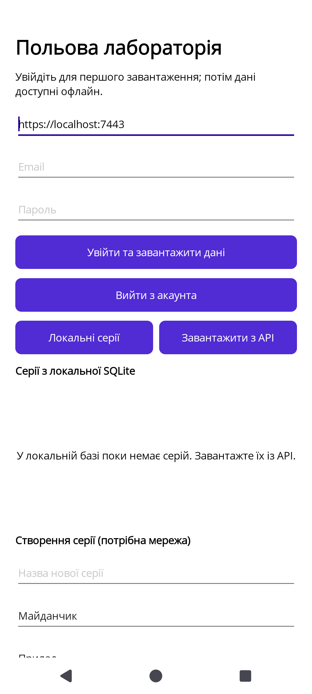

# Перевірка Z4 — 30.10.2026

Код: `c6dd8531321840605b0a5755aefefe3977a04148`, гілка
`feature/9-14-15-z4-completion`, база `ee42548`.
Перевірку виконав агент від імені @otmepush; Docker-команди та запуск ADB-сервера,
недоступні sandbox, виконав користувач. Результати не видаються за ручний прогін
усього UI-сценарію людиною.

## Що реалізовано

- #9: MVVM, вхід, захищена сесія, список серій зі спільного LabDbContext / SQLite,
  онлайн-створення серії та перегляд серверної статистики.
- #14: локальне внесення вимірів із UUID/UTC, довговічний журнал Pending/Sent/Failed,
  повтор після втраченої відповіді, явна політика конфліктів і рішення користувача.
  Наявний API використовується послідовно. Серверного 207/duplicate=true ще немає — #45.
- #15: перерахунок змінених серій через ядро Z1, версійний кеш, потокові CSV/JSON,
  чистка тимчасових файлів, cancellation і окремий Docker-стек перевірки.

## Середовище й адаптації

.NET SDK 10.0.401, Windows, Android SDK API 36, JDK 21, PostgreSQL 15.
Android-запуск: AVD Pixel 6 / Android 15 (API 35), x86_64, WHPX, програмний GPU.
Збірка APK на API 36 не вимагає Android 16 на пристрої: мінімальний API клієнта — 21.

NuGet у sandbox відновлювався через зовнішній локальний relay з HTTPS-перевіркою
сертифіката upstream. Конфігурацію NuGet репозиторію не змінено.
`Logging__EventLog__LogLevel__Default=None` задано тільки для локальних тестів через
заборону Windows Event Log для sandbox-акаунта. Інші провайдери журналу працювали.
Docker API named pipe недоступний sandbox. Користувач зібрав стек за підготовленим
compose, надав журнал і експорти. Тести отримали окрему БД
`sigma_z4_tests_20261030`, відмінну від демонстраційної `sigma_z4`.
Секрети залишилися в зовнішньому env-файлі й у цьому звіті не наведені.

## Повна Release-збірка

`dotnet build LabStem.slnx -c Release` включає сервер, Worker, тести, Windows та Android.
Дослівний підсумок:

```text
Сборка успешно завершена.
    Предупреждений: 0
    Ошибок: 0

Прошло времени 00:02:36.80
```

## Усі .NET-тести з PostgreSQL

З `LAB_TEST_POSTGRES=1` і власним `LAB_TEST_POSTGRES_CONNECTION`:

```text
dotnet test LabStem.Server.slnf -c Release --no-build --collect:"XPlat Code Coverage" --results-directory <свіжий каталог прогону>
```

Дослівні підсумки:

```text
Пройден!   : не пройдено     0, пройдено    73, пропущено     0, всего    73, длительность 181 ms. - Lab.Domain.Tests.dll (net10.0)
Пройден!   : не пройдено     0, пройдено   220, пропущено     0, всего   220, длительность 1 m 13 s. - Lab.Application.Tests.dll (net10.0)
Пройден!   : не пройдено     0, пройдено    49, пропущено     0, всего    49, длительность 3 m. - Lab.Postgres.Tests.dll (net10.0)
```

Разом **342 passed, 0 failed, 0 skipped**. Із них 21 нова перевірка Z4 порівняно з
28 початковими сценаріями Lab.Postgres.Tests. Тести перевіряють також 50 офлайн-команд
через справжній TestServer, втрату відповіді після commit у PostgreSQL, точність UTC
до мікросекунд, відновлення ViewModel без мережі та штатну зупинку Worker.

## Покриття та Python

Скрипт злиття викликано з RESULTS_DIR цього свіжого прогону, без зміни його логіки,
порога або фільтрів. Злиті тільки три нові XML:

```text
РАЗОМ solution: 4836/5004 = 96.64 %
Ядро (домен + прикладний шар + інфраструктура): 952/968 = 98.35 %
Поріг C3: 80 % - виконано
```

Це покриття збірок основного звіту. Клієнтські сервіси та SeriesProcessor підключені
до тестів за тим самим вихідним кодом; ці числа не є окремим покриттям MAUI UI чи Worker.

`python -m unittest discover -s scripts -p "test_*.py" -v`:

```text
Ran 21 tests in 1.956s
OK
```

## Android і Windows

APK встановлено на підготовлений емулятор Android 15; запущено launcher activity:

```text
Status: ok
LaunchState: COLD
Activity: ua.knu.sigma.lab.client/crc647a17e736ac8560db.MainActivity
TotalTime: 1800
WaitTime: 1803
Complete
Application PID=2316
```

Після запуску зняті UI XML і PNG. У відфільтрованому AndroidRuntime/DOTNET error-log
немає повідомлень. На стартовому екрані видно вхід, список локальних серій та дії
створення/внесення; на новій інсталяції список очікувано порожній.



Windows Release exe відкрив вікно. Accessibility tree підтвердив список серій,
поля входу, вибір ресурсів, внесення виміру, повтор/перебазування/відкидання та
статистику. Отримання PNG через Windows capture було недоступне; візуальний
end-to-end із заповненими даними на Windows цим не заявляється.

Дані в SQLite та відновлення заповненого списку перевірені тестами. Повний ручний
сценарій входу через довірений HTTPS-сервер на обох платформах залишається
додатковим прийманням інтерфейсу; тестовий Docker API навмисно лише HTTP на loopback.

## Docker Worker

Окремий compose підняв API, PostgreSQL і Worker. Через EF створено тестову серію
Id=1, Version=3 із двома вимірами 10 і 12. Із контейнера скопійовано CSV, JSON
та маніфест:

```json
{"experimentId":1,"version":3,"count":2,"unit":"\u00B0C","mean":11,"sampleStandardDeviation":1.4142135623730951,"standardError":1}
```

CSV зберігає `°C`, десяткові числа й UTC, JSON має обидва виміри. Тимчасових файлів
у зібраних результатах немає. Журнал підтвердив подію 3002; повторні цикли перевіряли
БД без повторної публікації тієї самої версії.

Перший runtime-образ друкував попередження про відсутню libgssapi_krb5.so.2;
додано libgssapi-krb5-2 і перевірено перезібраний образ. У фінальному журналі
немає fail/error/libgssapi-повідомлень, є:

```text
Application started. Press Ctrl+C to shut down.
Application is shutting down...
```

Користувач виконав docker stop, зібрав журнал і знову запустив Worker.

## Межі готовності

- #9: реалізація списку, тестів і запусків обох платформ готова до рев’ю; повний
  ручний UI-сценарій із серверними обліковими даними окремо не заявляється.
- #15: перерахунок, потоковий експорт, cancellation та Docker перевірені.
  Статистика використовує масив значень існуючого ядра; потоковими є проходи експорту.
- #14 лишається відкритим до серверного контракта #45: клієнтський звіт не є HTTP 207.
- Перший адміністратор (#40), підпис/доступ менеджера (#37/#38) і загальний стек (#10)
  належать іншим зонам. Їхні реалізації чи завершення цим PR не підміняються.
- Домен, міграції та публічні API DTO не змінювалися. Рішення 18–19 і META-USAGE оновлені.
